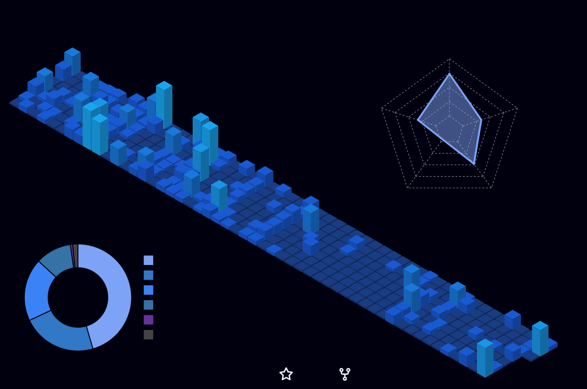

<!-- GitAscii Adaptive Profile (ASCII Portrait, Editorial Info Deck & Social Badges) -->
<picture>
  <source media="(prefers-color-scheme: dark)" srcset="https://raw.githubusercontent.com/AbinVarghexe/AbinVarghexe/main/profiles/default/dark.svg?v=17">
  <source media="(prefers-color-scheme: light)" srcset="https://raw.githubusercontent.com/AbinVarghexe/AbinVarghexe/main/profiles/default/light.svg?v=17">
  
</picture>

<!-- Active Social Radar Pills -->

  &nbsp;
  &nbsp;
  &nbsp;
  

 

<!-- GitHub Contribution & GitHub Stats (Immediately After GitAscii Card) -->
<table border="0" style="border: none;">
  <tr>
    <td align="center" style="border: none; padding: 6px;">
      
    </td>
    <td align="center" style="border: none; padding: 6px;">
      
    </td>
  </tr>
</table>

---

## About

I started out being drawn to visuals, layout systems, and design tools. Over time, that pulled me deeper into frontend engineering and product building, and now I enjoy working on projects where I can shape both the interface and the implementation.
  
Currently studying Computer Science and Engineering with a Minor in VLSI at Amal Jyothi College of Engineering (2023&ndash;Present). I approach every project as a real-world product rather than a simple exercise, focusing on solving complex problems and transforming rough concepts into polished, intuitive systems.

---

## Tech Stack

  &nbsp;&nbsp;&nbsp;&nbsp;
  &nbsp;&nbsp;&nbsp;&nbsp;
  &nbsp;&nbsp;&nbsp;&nbsp;
  &nbsp;&nbsp;&nbsp;&nbsp;
  &nbsp;&nbsp;&nbsp;&nbsp;
  

  &nbsp;&nbsp;&nbsp;&nbsp;
  &nbsp;&nbsp;&nbsp;&nbsp;
  &nbsp;&nbsp;&nbsp;&nbsp;
  &nbsp;&nbsp;&nbsp;&nbsp;
  &nbsp;&nbsp;&nbsp;&nbsp;
  

  &nbsp;&nbsp;&nbsp;&nbsp;
  &nbsp;&nbsp;&nbsp;&nbsp;
  &nbsp;&nbsp;&nbsp;&nbsp;
  

---

## Activity &amp; Atmosphere

<!-- Living Git-Koi, 3D Contribution Bar Chart & Spotify Stream in 3 Columns -->
<table border="0" style="border: none; border-collapse: collapse; width: 100%;">
  <tr style="border: none;">
    <td align="center" width="22%" style="border: none; padding: 6px; vertical-align: middle;">
      
    </td>
    <td align="center" width="46%" style="border: none; padding: 6px; vertical-align: middle;">
      
    </td>
    <td align="center" width="32%" style="border: none; padding: 6px; vertical-align: middle;">
      
    </td>
  </tr>
</table>

