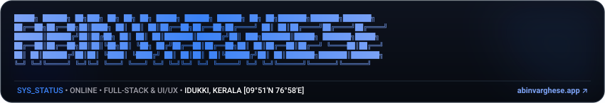
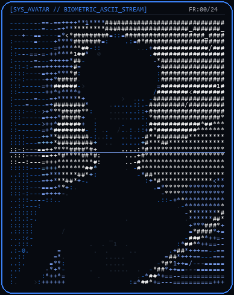
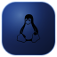
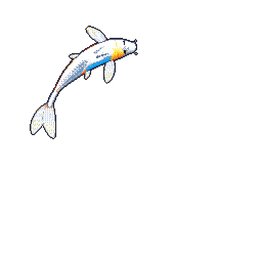

<!-- ASCII Masthead in Pure Black, Blue, White, Grey Palette -->

  

<!-- Animated ASCII Portrait Stream & Core Identity -->
<table border="0" style="border: none;">
  <tr>
    <td align="center" style="border: none; padding-right: 28px;">
      
       
      <em>Biometric ASCII Stream &bull; 24-Frame Loop</em>
    </td>
    <td align="left" style="border: none;">
<pre>
<b>IDENTITY</b>   &bull; Abin Varghese
<b>ROLE</b>       &bull; Full-Stack Engineer &bull; UI/UX Designer
<b>LOCATION</b>   &bull; Idukki, Kerala, India [09°51'N 76°58'E]
<b>FOCUS</b>      &bull; High-Performance Systems &bull; Thoughtful Interfaces
<b>PALETTE</b>    &bull; #070A10 &bull; #3B82F6 &bull; #FFFFFF &bull; #A1A1AA
<b>ENGINE</b>     &bull; Living Git-Koi &bull; Neural ASCII Terminal
</pre>
    </td>
  </tr>
</table>

<!-- Dynamic Typewriter Animation in Electric Blue -->

  

   &nbsp;
   &nbsp;
   &nbsp;
   &nbsp;
  

---

## About

> *"I design with purpose and build with precision — every pixel and every line of code is intentional."*

I started out being drawn to visuals, layout systems, and design tools. Over time, that pulled me deeper into frontend engineering and product building, and now I enjoy working on projects where I can shape both the interface and the implementation.

Currently studying Computer Science and Engineering with a Minor in VLSI at Amal Jyothi College of Engineering (2023–Present). I approach every project as a real-world product rather than a simple exercise, focusing on solving complex problems and transforming rough concepts into polished, intuitive systems.

---

## Tech Stack

### Languages & Libraries

<table>
  <tr>
    <td align="center" width="14%">
       
      <b>Python</b>
    </td>
    <td align="center" width="14%">
       
      <b>Go</b>
    </td>
    <td align="center" width="14%">
       
      <b>JavaScript</b>
    </td>
    <td align="center" width="14%">
       
      <b>HTML5</b>
    </td>
    <td align="center" width="14%">
       
      <b>C# • .NET</b>
    </td>
    <td align="center" width="14%">
       
      <b>SQLite</b>
    </td>
    <td align="center" width="14%">
       
      <b>OpenCV</b>
    </td>
  </tr>
</table>

### Infrastructure & Tools

<table>
  <tr>
    <td align="center" width="12.5%">
       
      <b>Linux</b>
    </td>
    <td align="center" width="12.5%">
       
      <b>Docker</b>
    </td>
    <td align="center" width="12.5%">
       
      <b>Git</b>
    </td>
    <td align="center" width="12.5%">
       
      <b>GitHub Actions</b>
    </td>
    <td align="center" width="12.5%">
       
      <b>Cloudflare</b>
    </td>
    <td align="center" width="12.5%">
       
      <b>Google Cloud</b>
    </td>
    <td align="center" width="12.5%">
       
      <b>WireGuard</b>
    </td>
    <td align="center" width="12.5%">
       
      <b>Tor</b>
    </td>
  </tr>
</table>

### AI Assistants

<table>
  <tr>
    <td align="center" width="16.6%">
       
      <b>Claude</b>
    </td>
    <td align="center" width="16.6%">
       
      <b>ChatGPT</b>
    </td>
    <td align="center" width="16.6%">
       
      <b>Gemini</b>
    </td>
    <td align="center" width="16.6%">
       
      <b>DeepSeek</b>
    </td>
    <td align="center" width="16.6%">
       
      <b>Qwen</b>
    </td>
    <td align="center" width="16.6%">
       
      <b>Kimi</b>
    </td>
  </tr>
</table>

---

## Activity & Atmosphere

<table border="0" style="border: none;">
  <tr>
    <td align="center" style="border: none; padding: 16px;">
      
       
      <b>Living Koi</b> &bull; Synchronized daily to commit activity via <a href="https://github.com/yalongwastaken/git-koi">git-koi</a>
    </td>
    <td align="center" style="border: none; padding: 16px;">
      
       
      <b>Audio Stream</b> &bull; Soundtracks powering development
    </td>
  </tr>
</table>

 

<table border="0" style="border: none;">
  <tr>
    <td align="center" style="border: none;">
      
    </td>
    <td align="center" style="border: none;">
      
    </td>
  </tr>
</table>

---

## Projects

| Project | Focus | Description | Link |
| :--- | :--- | :--- | :---: |
| **ABINFLIX** | Media Platform | Streaming web application with a responsive cinema UI and client-side performance optimizations. | [Code ↗](https://github.com/AbinVarghexe/ABINFLIX) |
| **LigthSuvara** | Educational Admin | Administrative dashboard with role-based access control, event scheduling, and student evaluation. | [Code ↗](https://github.com/AbinVarghexe/LigthSuvara-Web-App) |
| **SARAS Swarm** | Autonomous Systems | Multi-agent autonomous swarm coordination and real-time rover communication protocol. | [Code ↗](https://github.com/AbinVarghexe/SARAS-Swarm-System) |
| **Voltant & Resonance** | Web Development | High-converting web applications with clean animations and modern responsive architectures. | [Live ↗](https://www.abinvarghese.app/) |

---

## Recognitions

- **1st Prize** &bull; UI/UX Workshop &amp; Hackathon &mdash; *ACM Club, Amal Jyothi College of Engineering*  
  *Designed an EV charging navigation platform helping users effortlessly find and reserve charging spots.*
- **Best Mission Concept Award (Senior Category)** &bull; NASA Space Apps Challenge 2025 &mdash; *Blankspace Community*  
  *Honored for mission systems architecture and concept design at the Kanjirappally Local Chapter.*

---

## Connect

   &nbsp;
   &nbsp;
   &nbsp;
   &nbsp;
  

Crafted with intention &bull; © 2026 Abin Varghese

